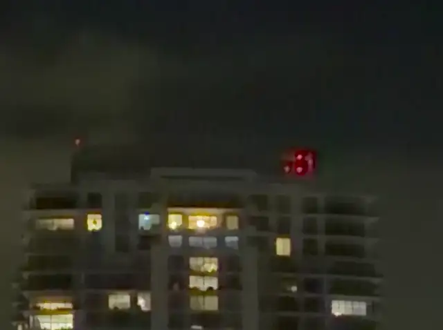
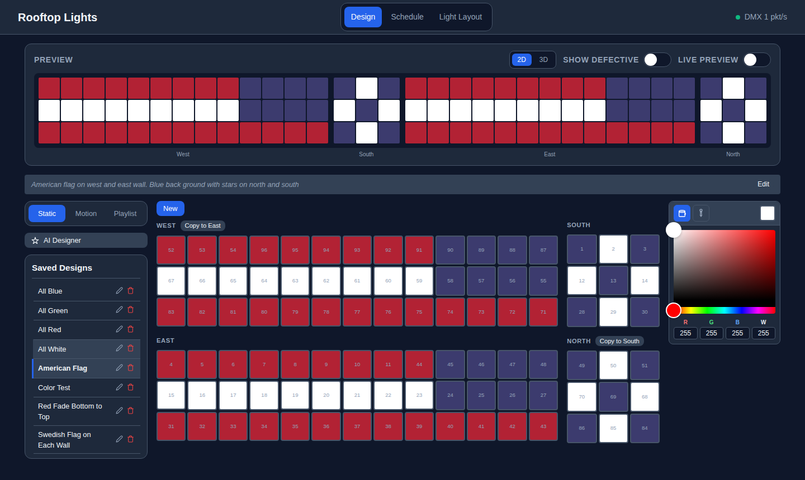
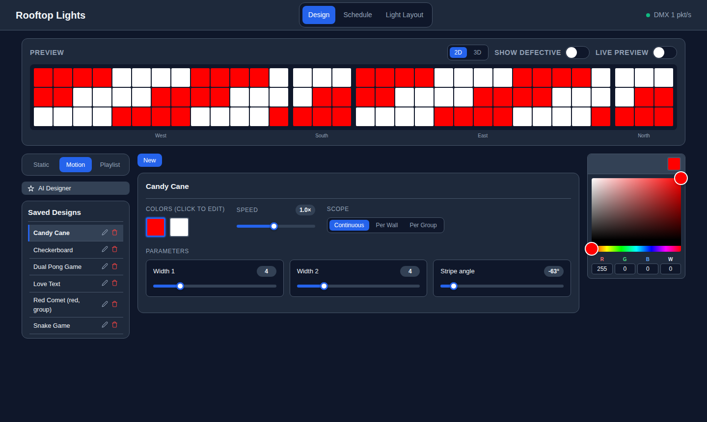
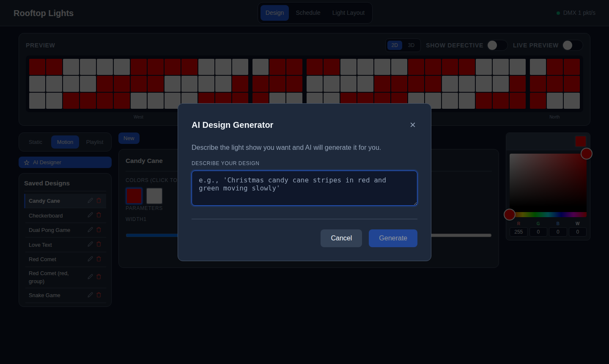
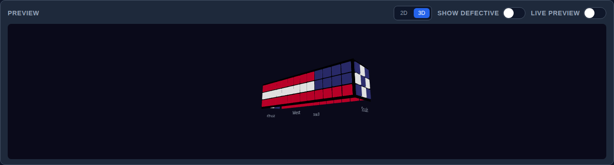
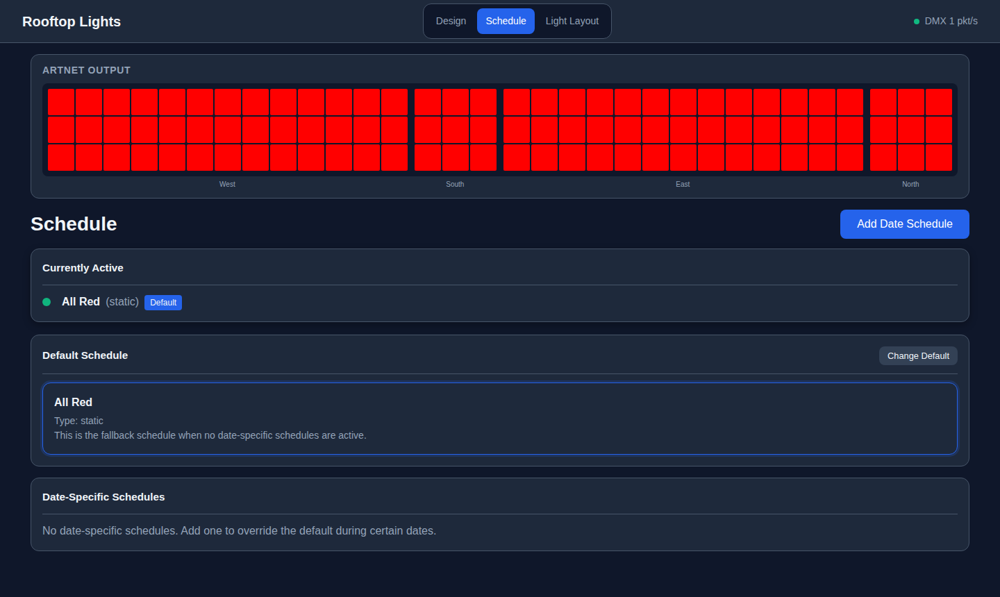
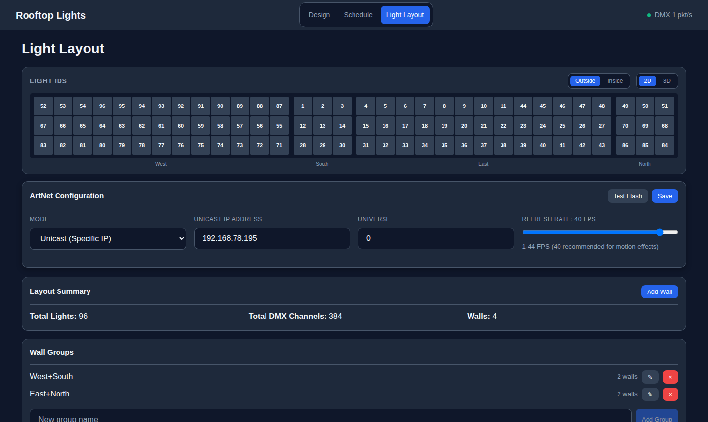
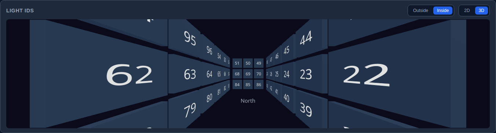

# Rooftop Lights

A web app for designing, previewing and scheduling shows on architectural RGBW lights over ArtNet/DMX. It was built to replace QLC+ for a rooftop installation of 96 fixtures on four walls, but walls, lights and DMX mapping are all configurable.

<p align="center">
  <a href="docs/video/rooftop.mp4"></a>
  <br>
  <em>The installation running on the roof. Click for the full clip.</em>
</p>

> [!WARNING]
> **There is no built-in authentication.** Anyone who can reach the web UI can control your lights, and AI effects run generated JavaScript on the server. Never expose it directly to the internet. Run it on a private network behind your own authentication, such as a reverse proxy with Authelia, Authentik, OAuth2 Proxy, Cloudflare Access or HTTP basic auth. See [Security](#security).



## Features

### Design

**Static designs.** Click or drag to paint lights with an RGBW color picker, pick up colors from existing lights, and copy one wall onto its opposite (West to East, North to South).

**Motion effects.** Each effect has its own colors, speed and parameters, and a scope: continuous around the whole perimeter, per wall, or per wall group. Per Wall can be limited to chosen walls. Comet, Rainbow and Wave take an angle (0° along the walls, 90° bottom to top), and Candy Cane takes a stripe angle. Comet can let its tail run fully out of frame before it loops.

| Effect | What it does |
|---|---|
| Candy Cane | Diagonal stripes scrolling around the perimeter |
| Checkerboard | Alternating squares that shift |
| Comet & Chase | Bright head (adjustable size) with a fading tail; Tail length 0 makes it a chase |
| Sparkle | Random lights twinkling over a base color |
| Rainbow | Smooth rainbow cycling across the display |
| Sine Wave | A readable sine curve drawn across the rows, rolling along the walls |
| Wave | Smooth waves rolling along the walls from a trough color to a crest color |
| Expand | Fills outward from the middle (or any start point) until full, then clears or shrinks back |
| Meet in the Middle | Two groups start at opposite ends and meet in the middle, with an optional comet tail |
| Breathe | All lights pulsing together |
| Text | Scrolling text |
| Twinkle | Lights fade in and out at random in the palette colors |
| Color Fade | The whole roof crossfades through the palette |
| Lightning | Random strikes of quick white flickers over a background color, optionally led by a bolt that drops from the top row |
| Fireworks | Bursts that expand from a random point and fade |
| Fire | Flickering flames, hotter along the bottom row |
| Strobe | Fast on/off flashing that cycles through the palette |
| Ripple | Rings spreading outward from a chosen point |
| Audio Level | A level meter driven by live audio (a microphone over UDP/HTTP, or this computer's mic) or simulated music; see [Audio input](#audio-input) |
| AI | Custom JavaScript animation written by the AI designer |



**Scenes.** A short combined piece built from designs only, for example Lightning for 5 s, then Fireworks 3 times, then a red fade. A scene plays its designs in order and loops. New items default to one complete cycle when the effect has one, otherwise to a number of seconds. Scenes have their own tab and show up in the design pickers tagged "Scene".

**Shows.** What you schedule for an evening. A show chains designs, scenes and other shows, played in sequence or at random. Each item plays for a number of seconds or a number of times: a motion effect that many complete cycles (static designs and random effects like Sparkle or Fire only take seconds), a scene or nested show that many times through. The editor shows each item's length and the show total. (Shows were called playlists before; the API and database still use `playlist`.)

**Timed events.** A show can also have timed events: a design, scene or show that plays at a time of day (for example 21:00), or every N minutes, optionally only between two times (for example every 30 minutes from 19:00 to 23:00). When an event comes due it interrupts the loop, plays for its seconds or times, and then the loop picks up where it left off. Its transition is used going in and coming back out. Times are the controller's local time (`TZ`).

Scenes and shows are the same thing underneath (one `playlists` table with a `kind`). A show can only become a scene if it holds designs only and has no timed events.

In the scene and show editors, **Play** plays what is in the editor right now, unsaved edits included, and highlights the item that is playing. Each item also has its own play button that starts from that item and carries on through the rest. It plays in the browser preview only, unless Live Preview is on. The Add picker can be searched, and its rows can be dragged into the list at any position (on phones, tap + to add at the end).

**Editing designs inside a scene.** Each design row in the scene editor has a pencil button that opens the Static painter or the Motion editor right under the row (one at a time). While it is open the preview shows that design (on the lights only with Live Preview on); closing it goes back to the scene, carrying on where it was playing. **Save** updates the design itself, so it changes everywhere it is used; when it is also used in other scenes or shows the editor says so, and **Save as copy (only this scene)** saves the edits as a new design (named "… (copy)") and puts it in this row instead. **+ New static** and **+ New motion** under the list start a new design in place; saving asks for a name and folder and adds it to the end of the scene. New designs and copies are filed with the scene: in its folder, or, when the scene is unfiled, in a new folder named after the scene, which the scene moves into as well (pick another folder in the prompt to opt out). A scene has to be saved (named) before designs can be created in it. Cancel discards the edits, and closing the editor, switching rows or leaving the tab asks first when there are unsaved changes. The scene itself still needs its own Save.

**Folders.** Static and motion designs, scenes and shows can be filed into folders. Pick a folder or make a new one when you save, or use the folder button on a saved item to move it (Unfiled included). The saved lists, the Add pickers and the Schedule pickers group items by folder, with Unfiled first. A folder is just a label, shared by all four tabs, and exists only while something is in it. Its header collapses (remembered per browser), renames the folder everywhere (renaming onto an existing folder merges them), or deletes it, which moves its items to Unfiled and deletes nothing.

**AI designer.** Describe a show in plain language ("a warm sunset from orange in the west to purple in the east") and Claude creates a new design, modifies an existing one, or writes a custom animation. It knows the layout, the available effects and your saved designs. This feature is optional and only appears when `ANTHROPIC_API_KEY` is set.

**AI Scene Creator.** In the Scenes tab, **AI Scene Creator** plans a whole scene from a description ("spooky Halloween intro", "calm sunset, then stars"). Claude picks an ordered list of designs: your saved designs where they fit, new designs from the built-in effects (with their params, colors and speed), still per-wall designs, and custom code only when no built-in effect can do it. It also sets each item's timing (whole cycles or seconds) and transition, aiming for about 20 to 90 seconds unless you ask for something else. The server checks the plan before saving anything: params are clamped to their ranges, unknown design ids and code that doesn't compile are skipped (listed as adjustments), and the new designs and the scene are saved together in the folder you picked, or in a folder named after the scene. The new scene opens in the editor with the AI's summary, **Play**, and **Undo**, which deletes the scene and the designs made for it that nothing else uses.

**Defective lights in AI prompts.** The AI Designer, its edit prompt and the AI Scene Creator have an **Account for defective lights** switch (on by default, remembered per browser). On, Claude gets the map of dead channels and picks colors that still read well on the working ones. Off, it treats every channel as working.



### Preview

Every page has a live preview fed over WebSocket, in 2D (the walls unrolled into one strip) or 3D (an orbitable model of the walls). Editing a design previews it in the browser only. Turning on **Live Preview** also sends it to the real lights until you turn it off. **Show Defective** simulates what lights with broken channels will actually show.



### Live & Schedule

- A **default** design, scene or show plays whenever nothing else is scheduled.

The header shows a small live view of what the lights are showing, next to the DMX rate. Click it to open a larger view under the header in its place, which stays open on every page until you close it with × (remembered per browser). It always shows the real output, even while the Design page previews something else.
- **Date schedules** override it between a start date and time and an end date and time, and a priority decides between overlapping schedules.
- The ArtNet output strip at the top shows exactly what is being sent to the lights right now.



### Light Layout

- Walls with custom width and height, ordered around the perimeter and grouped (for example West+South) for per-group effects.
- For each light: its ID, type (RGB or RGBW), DMX start channel and any defective channels (R, G, B or W) to mask out.
- A **Light IDs** preview labels every fixture with its ID, in 2D or 3D, seen from **Outside** or from **Inside** (standing in the middle looking out). Clicking a light opens its settings.
- ArtNet settings: unicast or broadcast, universe, refresh rate (1–44 FPS), plus a test flash.
- **Audio Inputs**: every audio source the server hears, with a live level bar, last seen, packets per second and sender address, a **Use this computer's microphone** button, and copy-paste ESP32 / curl / netcat examples filled in with this server's address.





## Default layout

On first start the database is seeded with 96 RGBW lights:

| Wall | Size | Lights |
|---|---|---|
| West | 13 × 3 | 39 |
| South | 3 × 3 | 9 |
| East | 13 × 3 | 39 |
| North | 3 × 3 | 9 |

Each RGBW light uses 4 DMX channels (R, G, B, W), starting at `((light_id - 1) * 4) + 1`, so the default layout fills 384 channels of one universe. Lights can be patched past channel 512: channel `N` goes to universe `base + floor((N - 1) / 512)`, for up to 16 universes. A light can't straddle a universe boundary.

## Tech stack

- **Backend:** Node.js 24, Express, TypeScript, better-sqlite3, ws
- **Frontend:** React 19, TypeScript, Vite 8, React Router 7, react-colorful, three.js via @react-three/fiber 9
- **Protocol:** ArtNet (ArtDMX over UDP 6454)
- **Database:** SQLite (WAL mode)
- **AI (optional):** Anthropic Claude API

A scheduler loop runs at about 30 FPS. It renders the active schedule (or live preview), sends DMX only when the frame changes or the content is animated, and pushes every third frame to browsers over `/ws`.

## Running it

Everything is served on port **3030** (web UI, API and WebSocket). ArtNet goes out on UDP **6454**.

Data lives in an external Docker volume, so create it once:

```bash
docker volume create rooftop-data
```

To enable the AI designer, put your key in a `.env` file next to `docker-compose.yml`. It is gitignored.

```bash
ANTHROPIC_API_KEY=sk-ant-...
```

### Production

```bash
GIT_COMMIT=$(git rev-parse --short HEAD) docker compose up -d --build
open http://localhost:3030
```

`GIT_COMMIT` is optional. It's shown, together with the version and build time, at the bottom of the Light Layout page's summary and in `GET /health`.

### Development (hot reload)

```bash
docker compose -f docker-compose.dev.yml up --build
```

This runs Vite on 3030 with the backend on 3031 behind it, and mounts `backend/src` and `frontend/src` so edits apply immediately. Dev and production use the same ports, so run only one at a time.

### Without Docker

```bash
cd backend && npm install && npm run dev     # API on :3030
cd frontend && npm install && npm run dev    # UI on :5173, proxies /api and /ws to the backend
```

### Tests

```bash
cd backend && TEST_DB=/path/to/a/copy/of/rooftop-lights.db npm test
```

The tests copy that database again to a temp file, so the file you pass is never changed.

### Environment variables

| Variable | Purpose | Default |
|---|---|---|
| `PORT` | HTTP port | `3030` |
| `DATABASE_PATH` | SQLite file | `/app/data/rooftop-lights.db` |
| `ANTHROPIC_API_KEY` | Enables the AI designer and AI Scene Creator | unset |
| `ANTHROPIC_MODEL` | Claude model for the AI designer and AI Scene Creator | `claude-sonnet-5-5` |
| `TZ` | Timezone used to evaluate schedule times | `America/New_York` (set in the compose files) |
| `CORS_ORIGINS` | Extra origins allowed to call the API, comma-separated | same origin only |
| `AI_CODE_TIMEOUT_MS` | Time budget per frame for AI effect code | `20` |
| `AUDIO_UDP_PORT` | UDP port for live audio levels (`0` disables) | `7000` |
| `NODE_ENV` | `production` or `development` | `production` |

Schedule times are evaluated in the container's `TZ`, and the Live & Schedule page shows which zone that is. Local development without Docker needs Node 20.19+ or 22.12+; the images use Node 24.

### Health check

`GET /health` checks the database and returns `{ "status": "healthy", "uptime": "..." }`. The Docker images use it as their `HEALTHCHECK`, so a hung process gets restarted.

## Security

The app has **no authentication**. Anyone who can reach port 3030 can change the lights. Keep it on a private network and put it behind an authenticating reverse proxy.

These protections are built in:

- **AI effect code runs in a sandbox.** It runs in a separate `node:vm` context with no `require`, `process`, `eval` or `Function`, and gets a read-only copy of its inputs. Each frame has a time budget of 20 ms by default. Code that throws or runs too long is switched off for 10 seconds, and its lights go dark. A `vm` context isn't a hard security boundary, so the reverse proxy is still needed.
- **Writes from other sites are rejected.** Cross-origin requests that change data (POST, PUT, DELETE) are refused unless the origin is listed in `CORS_ORIGINS`. That stops other web pages from controlling the lights through a visitor's browser.
- **Invalid input gets a 400.** Bad designs, playlists, schedules and light settings are rejected with a clear error. A broken design that is already stored can't crash the render loop.

## API

| Area | Endpoints |
|---|---|
| Layout | `GET /api/layout/layout`, `GET/POST /api/layout/walls`, `PUT/DELETE /api/layout/walls/:id`, `POST /api/layout/walls/reorder`, `POST /api/layout/lights`, `PUT/DELETE /api/layout/lights/:id`, `GET/POST /api/layout/groups`, `PUT/DELETE /api/layout/groups/:id` |
| Designs | `GET/POST /api/designs`, `GET/PUT/DELETE /api/designs/:id`, `POST /api/designs/:id/copy`, `GET /api/designs/effects/types` |
| AI | `GET /api/designs/ai/status`, `POST /api/designs/ai/generate` `{ description, considerDefective? }`, `POST /api/playlists/ai/generate` `{ description, folder?, considerDefective? }` (plans and saves a scene), `POST /api/playlists/:id/ai-undo` `{ designIds }` |
| Playlists & scenes | `GET /api/playlists[?kind=scene\|playlist]`, `POST /api/playlists`, `GET/PUT/DELETE /api/playlists/:id`, `POST /api/playlists/:id/convert`, `POST /api/playlists/:id/items`, `PUT/DELETE /api/playlists/:id/items/:itemId`, `POST /api/playlists/:id/reorder` |
| Folders | `GET /api/folders` (names with counts per kind), `PUT /api/folders/:name` `{ name }` (rename or merge), `DELETE /api/folders/:name` (unfile); designs and playlists take `folder` on POST/PUT |
| Schedules | `GET/POST /api/schedules`, `PUT/DELETE /api/schedules/:id`, `GET/POST /api/schedules/default`, `GET /api/schedules/active` |
| Preview | `GET /api/preview/status`, `POST /api/preview/start`, `/effect`, `/playlist`, `/lights`, `/stop`, `/clear-soft` |
| ArtNet | `GET/PUT /api/artnet/config`, `GET /api/artnet/status`, `POST /api/artnet/test` |
| Audio | `POST /api/audio/level`, `GET /api/audio/sources`, `GET /api/audio/status` (see [Audio input](#audio-input)) |

### WebSocket

Connect to `/ws` to receive:

- `{ type: "layout", data: { walls, lights } }` once on connect
- `{ type: "frame", data: { [lightId]: { r, g, b, w } }, dmxRate }` about 10 times per second

and to send browser microphone levels: `{ type: "audio", id, level, peak, seq }` (same fields as [Audio input](#audio-input); only from pages served by this server).

```javascript
const ws = new WebSocket(`ws://${location.host}/ws`);
ws.onmessage = (event) => {
  const msg = JSON.parse(event.data);
  if (msg.type === 'frame') console.log(msg.data[1]); // color of light 1
};
```

## Audio input

The **Audio Level** effect draws a level meter: lights fill along each segment (Continuous, Per Wall with the wall picker, or Per Group) from left to right, right to left, from the center out, or up the rows, blending from the Low through the Mid to the High color, with an optional peak-hold marker and sub-pixel blending at the edge of the fill. Gain, attack, release and peak hold time are in seconds and ignore Speed. **Auto gain** follows the loudest level of the last ~10 seconds so it fills the meter, boosting at most 4× so a quiet room stays dark. **Input: Simulated music** needs no hardware (a beat at the chosen tempo); **Live audio input** follows a source by id (blank follows whichever source sent most recently).

Senders send one reading per packet, 30–50 per second:

```json
{"id":"mic-1","level":42.5,"peak":71,"seq":1234}
```

| Field | | |
|---|---|---|
| `level` | required | 0–100. The ESP32 example maps RMS from −60..0 dBFS to 0..100 |
| `peak` | optional | 0–100, shown on the Light Layout page |
| `id` | optional | source name, up to 64 characters; default `default` |
| `seq` | optional | increasing counter; older or repeated packets are dropped. A big jump back (50+), five "late" packets in a row, or 5 s of silence counts as a restart |

- **UDP** (preferred): one JSON object per datagram to port `AUDIO_UDP_PORT` (7000, published by the compose files), at most 512 bytes. Malformed packets are ignored and logged at most once a minute.
- **HTTP**: `POST /api/audio/level` with the same JSON, or an array of readings. Returns `{ accepted, rejected }`. Requests without an `Origin` header (curl, an ESP32) are allowed, like the rest of the API.
- **This computer's microphone**: the **Use this computer's microphone** button on the Light Layout page (and next to the effect's source field) asks for mic permission, measures the level in the browser with the same 0–100 scale, and streams it over the page's WebSocket (`{"type":"audio", ...reading}`), falling back to HTTP. Source id defaults to `browser-<browser>-<os>` and can be changed. It needs https or localhost, stops with the Stop button, when the tab closes, or after the tab has been hidden for 30 s. Background tabs are throttled by the browser to about one reading a second.
- `GET /api/audio/sources` lists sources heard in the last 10 minutes: `id`, `level` (now, with the timeout fade), `raw`, `peak`, `lastSeen`, `ageMs`, `packetsPerSecond`, `address`, `transport`. `GET /api/audio/status` returns the UDP port and whether it is listening.

A source that stops sending holds its last level for 1 s, then fades to 0 over 0.5 s.

Test from a terminal:

```bash
echo -n '{"id":"test","level":60}' | nc -u -w0 <server> 7000
curl -X POST -H 'Content-Type: application/json' -d '{"id":"test","level":60}' http://<server>:3030/api/audio/level
```

ESP32 (Arduino) sketch for an analog microphone module (MAX4466 / MAX9814 on GPIO 34); the Light Layout page shows it with your server's address filled in:

```cpp
#include <WiFi.h>
#include <WiFiUdp.h>

const char* SERVER = "192.168.1.50";  // the rooftop server
const uint16_t PORT = 7000;
WiFiUDP udp;
uint32_t seq = 0;
float dc = 2048, peak = 0;

float readLevel() {  // RMS over ~20 ms, -60..0 dBFS -> 0..100
  double acc = 0; int n = 0; uint32_t start = millis();
  while (millis() - start < 20) {
    float s = analogRead(34);
    dc += (s - dc) * 0.001f;
    float v = (s - dc) / 2048.0f;
    acc += v * v; n++;
  }
  float db = 20.0f * log10f(sqrt(acc / max(n, 1)) + 1e-6f);
  return constrain((db + 60.0f) * (100.0f / 60.0f), 0.0f, 100.0f);
}

void setup() {
  WiFi.begin("your-wifi", "your-password");
  while (WiFi.status() != WL_CONNECTED) delay(250);
}

void loop() {
  float level = readLevel();
  peak = max(level, peak * 0.95f);
  char msg[96];
  int len = snprintf(msg, sizeof msg, "{\"id\":\"mic-1\",\"level\":%.1f,\"peak\":%.0f,\"seq\":%lu}",
                     level, peak, (unsigned long)seq++);
  udp.beginPacket(SERVER, PORT);
  udp.write((const uint8_t*)msg, len);
  udp.endPacket();
  delay(5);  // about 40 readings per second
}
```

The UDP port has no authentication either: anything on the network can send levels. They only affect designs that use the Audio Level effect with live input.

## Project structure

```
backend/src/
  index.ts                 Express server, WebSocket, /health
  artnet/artnet.ts         ArtNet UDP sender
  scheduler/scheduler.ts   Render loop, schedules, playlists, preview
  services/effectEngine.ts Motion effects
  services/aiDesigner.ts   Claude integration
  models/database.ts       SQLite schema, migrations, default layout
  routes/                  REST API
frontend/src/
  pages/                   Design, Schedule, Light Layout
  components/              3D preview, light ID preview
  hooks/useWebSocket.ts    Live frames
docs/screenshots/          Images used in this README
```

## License

MIT
